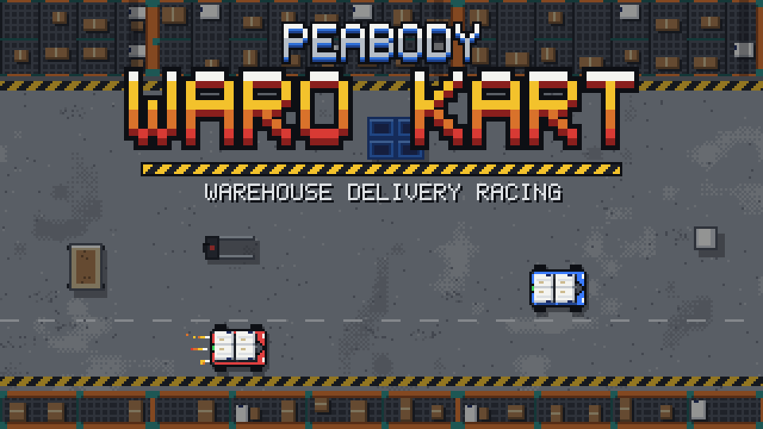
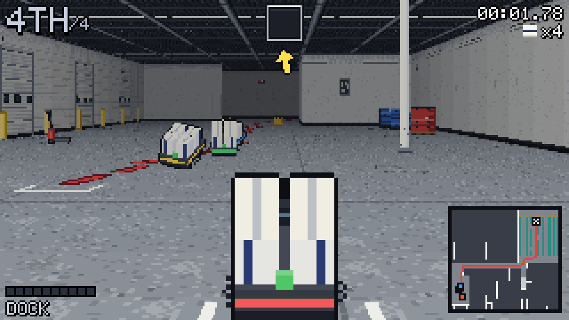
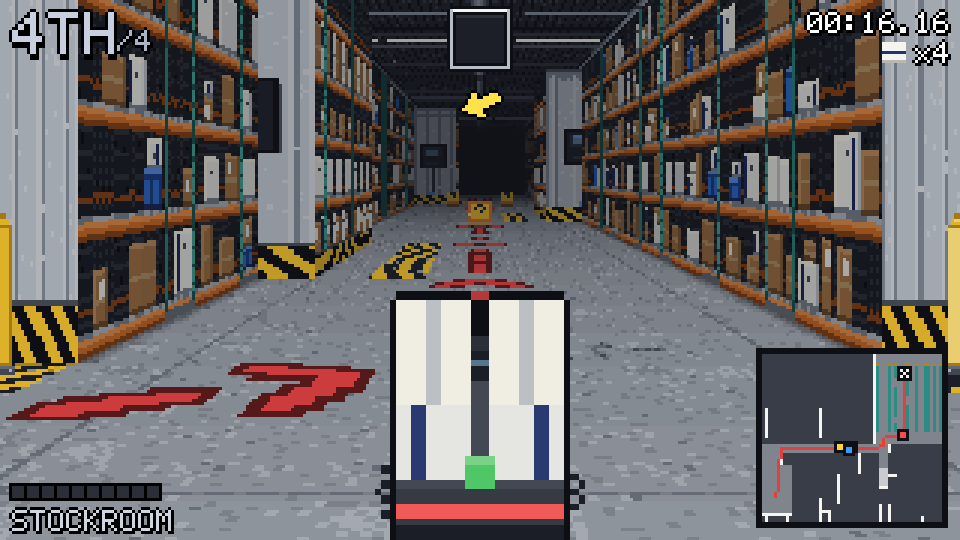
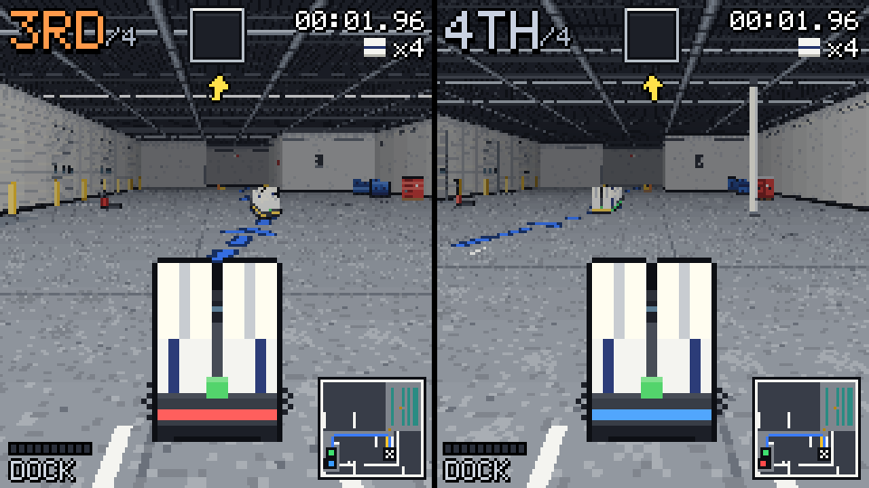
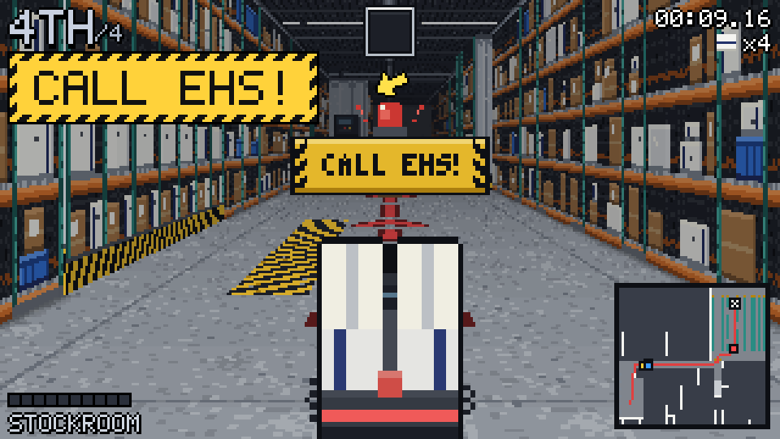

# WaRo Kart 🎃

### ▶️ [Play now: harnwaln.github.io/waro-kart](https://harnwaln.github.io/waro-kart/)

Hop on an AGV loaded with boxes and race the delivery routes of the Peabody warehouse: out of the Dock, down the Main
Hall, then up into the Stockroom or over to the Decon Doors. Grab item pallets, dodge the swinging doors and the sliding
racks, and keep your boxes on board. Every box you drop adds 2 seconds to your time. Crash too hard and you'll have to
**CALL EHS!**

Nothing to install: open the link in a browser and press Enter.

## How to play

| | Player 1 | Player 2 |
|---|---|---|
| Drive | W A S D | Arrow keys |
| Use item | Space | Enter |
| Drift | Left Shift | Right Shift |

**Esc** pauses and **M** mutes. Playing solo? The arrow keys and Enter work too.

Pick one of three modes:
- **1 Player**: race 3 computer AGVs.
- **2 Player**: split screen on one keyboard.
- **Time Trial**: chase your best time.

Then pick a route: the **Stockroom Run**, the **Decon Run**, or the **Double Delivery**, which does both.

## Items
- 🏷️ **Priority Label**: a burst of speed.
- 🎁 **Shrink-Wrap**: leave a sticky trap behind you.
- 🥜 **Packing Peanuts**: spin out whoever drives over them.
- 📦 **Spare Box**: get a lost box back.
- 📡 **Lidar Ping**: make the AGV ahead of you CALL EHS!

Psst... stick around on the results screen. 👨‍🍳

---

## 🎃 Happy Halloween, everyone! 👻
